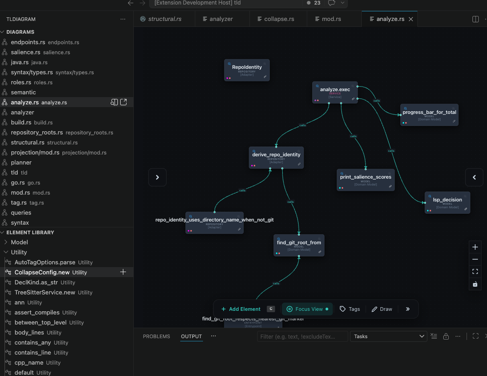

# tlDiagram for VS Code

Browse and edit tlDiagram architecture diagrams without leaving VS Code. The extension is backed by the local `tld` CLI and uses the open-source core UI from `tld/frontend`.


## Features

### Diagram editor in a webview panel
Open any diagram from the Diagrams tree and the full React canvas loads inside VS Code, including the in-canvas Element Inventory and View Explorer panels. The same diagrams can also be browsed from the native sidebar tree views.

### Native sidebar tree views
The extension contributes views in the **tlDiagram** activity bar container:

| View | What it shows |
|---|---|
| **Diagrams** | Diagram hierarchy, including parent/child relationships, with create, rename, delete, open, and open-in-browser actions |
| **Element Inventory** | Reusable elements grouped by kind, with an **Add to Diagram** action that places the element into the active diagram |
| **Watch Changes** | Live file changes produced by `tld index --watch`; click a file to open the repository change canvas and focus its change (local mode only) |

### Workspace source linking
Inside the webview, the source picker browses workspace files and asks VS Code for symbols in the selected file. Links are stored in the same shape the web app uses, so they work everywhere.

CodeLens and `Ctrl/Cmd+T` symbol search jump from source symbols to their diagram, and **Open in Editor** jumps back from a diagram element to its source.

### Local CLI mode
Requires **tld v2.4.3 or newer**. The extension starts `tld serve --foreground` for the current workspace and talks to its ConnectRPC API. Repository indexing runs separately through `tld index --watch --map`; stopping indexing keeps diagrams available. Set `tlDiagram › Cli Path` if `tld` is not on `PATH`. Run **tlDiagram: Analyze Folder** to index a codebase, or **tlDiagram: Start Watching** for continuous sync.

### Logging
All extension activity is written to the **tlDiagram** output channel. The verbosity is controlled by `tldiagram.logLevel`.

## Commands

| Command | Where it appears | Description |
|---|---|---|
| `tlDiagram: Refresh Diagrams` | Command palette, tree toolbar | Re-fetch diagrams and refresh the element inventory |
| `tlDiagram: New Diagram` | Command palette, tree toolbar | Create a blank diagram |
| `Open Diagram` | Diagram item context menu | Open the selected diagram in the webview panel |
| `Open in Browser` | Diagram item context menu | Open the selected diagram on the local tld server |
| `Rename Diagram` / `Delete Diagram` | Diagram item context menu | Rename or delete the selected diagram |
| `Add to Diagram` | Element Inventory item context menu | Place the selected element into the active diagram |
| `Go to Diagram` | Editor / Explorer context menu, CodeLens | Open the diagram that contains the current symbol |
| `tlDiagram: Analyze Folder` | Explorer folder context menu | Run `tld index <folder> --map` for the folder |
| `tlDiagram: Start Watching` / `Stop Watching` | Command palette, status bar | Control repository indexing through the local server |
| `tlDiagram: Show Watch Changes` | Command palette | Reveal the Watch Changes view |
| `tlDiagram: Install or Update CLI` | Command palette | Install the CLI or run `tld version update` |
| `tlDiagram: Show Logs` | Command palette | Open the tlDiagram output channel |
| `tlDiagram: Configure UI Colors` | Command palette | Import VS Code theme colors or pick a palette |

## Requirements

- VS Code 1.85+
- The `tld` CLI
- The extension and webview bundles must be built before loading from source

## Development

```bash
npm install
npm run compile   # extension host + webview
npm test          # unit tests
npm run test:e2e  # launches VS Code against a temporary fixture workspace
```
